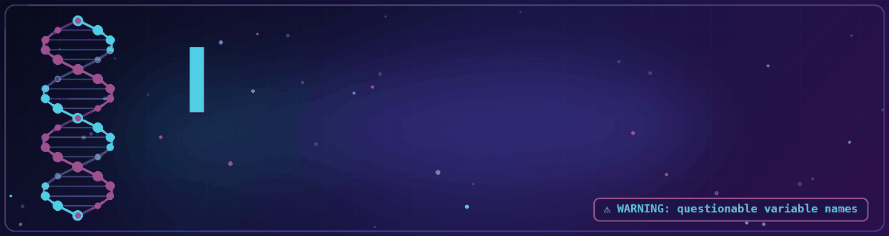

> ⚠️ **WARNING:** This profile contains traces of genomics, questionable variable names, an unhealthy attachment to *S. aureus*, and a dangerous amount of Python. Proceed with caution.

> 🧾 **TL;DR:** Biochemist. Self-taught bioinformatician. I turn petabytes of pathogen genomes into things public health people can act on. Also I argue about football.

---

### 🧬 The Human Behind the Pipelines

BSc Biochemistry from **KNUST**. Self-taught bioinformatician. I take huge messy sequencing data and turn it into insights people can actually use.

I break code and I fix code, and I will be honest, mostly I am touching things I should not be touching. It usually works out.

I am resilient regardless of what you say. I always think comeback. Because I am **Culer**💙❤️. **Blaugrana**💙❤️. That Barcelona. Yes, this is a bioinformatics profile and yes, that is relevant to my personality. 

---

### ☠️ The ESKAPEE Obsession

ESKAPEE pathogens are the reason I wake up. *Enterococcus faecium*, *Staphylococcus aureus*, *Klebsiella pneumoniae*, *Acinetobacter baumannii*, *Pseudomonas aeruginosa*, *Enterobacter* spp., and *Escherichia coli*. The whole resistance gang.

My favourite bug is ***S. aureus***. Not because it is charming. Because its 2.9 MB genome fits comfortably inside my 500 GB storage, and I respect a pathogen that knows how to travel light.

Pathogenesis and virulence are my home turf. I want to know how these things cause damage, and how we catch them doing it.

---

### 🎓 Next Stop: A PhD in Microbiology and Infectious Disease

I am actively seeking a **PhD in Microbiology and Infectious Disease**.

Here is the pitch in one line: I want to **translate pathogen genomic data into clinical and public health action**. Not just produce another figure. Not just deposit another assembly. Translate. From a FASTQ file sitting on a server to a decision someone can make about an outbreak, a treatment, or a resistance mechanism.

I bring the wet-side literacy of a biochemistry degree and the dry-side muscle of self-taught bioinformatics. I can talk to the microbiologist at the bench and to the person maintaining the cluster. I have shipped tools that other people use. I have broken things and fixed them and learned the difference.

If your lab works on ESKAPEE pathogens, antimicrobial resistance, virulence, or genomic surveillance, we should talk. I come with pipelines and opinions.

**Open to PhD positions · Microbiology · Infectious Disease · AMR · Genomic Epidemiology**

---

### 🛠️ The Pinned Arsenal (Six Slots, Six Pathogens)

  
**StaphScope** · unified MLST, spa, SCCmec, AMR, virulence, plasmid and capsule typing for *S. aureus*. MRSA’s least favourite pipeline.

**EcoliTyper** · nine analyses, one automated run. *E. coli* genotyping that finishes in minutes instead of your entire afternoon.

**AcinetoScope** · seven analysis modules from FASTA to actionable report. Built for *A. baumannii* outbreak investigations and carbapenemase tracking.

**PseudoScope** · MLST, PAST serotyping, AMR, virulence, and a visualisation dashboard for *P. aeruginosa*. Runs locally so your data stays your data.

**ESKAPE Web Platform** · seven species pipelines behind one browser interface. Live at [eskape.bio](https://eskape.bio), built so people without a terminal can still use the tools.

**SAURUS** · 134,299 *S. aureus* genomes, eleven typing and annotation modules, one queryable interface. Web at [saurus-db.org](https://saurus-db.org), CLI at `pip install saurus-cli`.

---

### 🗄️ The Unpinned Vault

The repos that did not get a pin slot but still do real damage.

>**EnteroScope** · tailored workflow for the *Enterobacter cloacae* complex. CREC analysis, HPC-friendly, mutation reporting included.

>**ABYSS** · *A. baumannii* genomic resource. Pasteur MLST, IC lineages, capsule typing, carbapenemases, metadata, and one-click accession export.

>**ECLIPSE** · *E. coli* surveillance resource. Stack filters by ST, phylogroup, serotype, or gene content and leave with a clean accession list.

>**SAURUS-CLI** · the terminal side of SAURUS. Query 134k genomes, filter by lineage and geography, export accessions. Bundled data, no API keys, no network calls.

>**saurus-db.org** · the domain and website behind SAURUS. Point, click, filter, export. The database’s public face.

---

### 🛰️ Current Mission: ARGUS

ARGUS is **Antimicrobial Resistance Genomic Unified Surveillance**. One family of independent, open genomic surveillance sites, one per WHO priority ESKAPE pathogen. Accession-first, metadata-integrated, no login, no install, MIT licensed.

The current line-up: SAURUS for *S. aureus*, ECLIPSE for *E. coli*, ABYSS for *A. baumannii*. More siblings are planned. The goal is simple to say and annoying to build: ingest raw sequencing data, type it, cluster it, and surface outbreaks before they become headlines.

Watch the repos. It is going to be good.

---

### ☕ Off the Clock

- **QIIME and the microbiome.** Currently learning. The microbiome is humbling and I respect it.
- **Python.** Always Python. It is the one relationship that has lasted.
- **AI, used properly.** I am learning to use it better every single day instead of pretending I already do, which is the most honest sentence in this README.
- **Football.** See above. Blaugrana. No further questions.

---

### 🏆 The Trophy Shelf

  

**Star history for SAURUS, because it is the one carrying the family name:**

---

### 📊 The Stats Section (Because Everyone Has One)

---

### 🧰 Stack and Daily Drivers

**Right now I am:** learning microbiome analysis with QIIME, living in Python, and learning to use AI better every single day instead of pretending I already do. (Yes, it is repeated. It is that important.)

---

### 💭 Random Dev Quote

---

### 📬 Connect

*Visca el Barça💙❤️. Visca the ESKAPEE gang. And may your pipelines always exit with code 0.*

